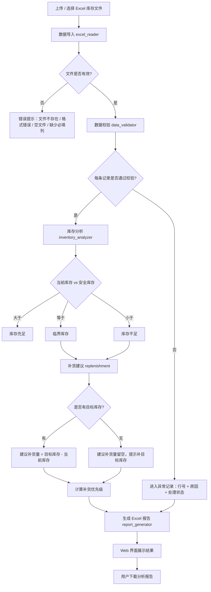

# 业务自动化流程

## 完整流程图（Mermaid）

## 各阶段说明

1. **数据导入**：读取 `.xlsx`，按表头名称自动识别列；跳过完全空白的行；文件不存在、格式错误、空文件、缺少必填列时给出中文错误提示。

2. **数据校验**：
   - 商品名称不能为空
   - 当前库存 / 安全库存不能为空、必须为数字、不能为负数
   - 目标库存 / 商品单价（可选）若填写必须为数字
   - 商品编号重复检查
   - 未通过的记录进入「异常记录」，带 Excel 原始行号和原因

3. **库存分析**（业务规则集中在 `config/settings.py`）：
   - 库存充足：当前库存 > 安全库存
   - 临界库存：当前库存 == 安全库存
   - 库存不足：当前库存 < 安全库存
   - 库存缺口 = max(安全库存 - 当前库存, 0)

4. **补货建议**：
   - 只有库存不足 / 临界的商品进入补货清单
   - 有目标库存时：建议补货量 = 目标库存 - 当前库存
   - 无目标库存时：不编造数量，建议补货量留空
   - 优先级（可配置）：缺货（≤0）→ 急需；缺口占比 ≥ 50% → 高；其余不足 → 中；临界 → 低

5. **报告生成**：4 个工作表（总览 / 明细 / 补货建议 / 异常记录），带表头样式、列宽、冻结窗格、自动筛选、状态标识色和时间戳文件名。

6. **Web 展示与下载**：Streamlit 界面展示各项指标和明细，支持筛选、搜索，并提供报告下载。
